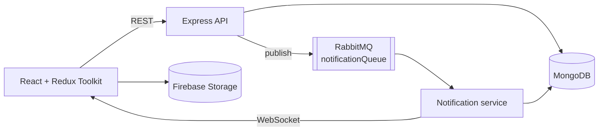

# TechConnect

A blog platform for developers, built on the MERN stack for the BUPT JavaEE summer term (2024). Writers publish posts; readers comment, like and search; everyone gets notified in real time when something happens to their posts.

## Features

- **Accounts.** Email sign-up and sign-in with JWT cookies, "remember me", Google sign-in through Firebase, and password reset by email.
- **Posts.** A rich-text editor plus Markdown file import, image upload to Firebase Storage, categories, a home page carousel, and click tracking.
- **Discussion.** Comments with likes, edit and delete; an admin dashboard for users, posts and comments.
- **Search.** Search across posts with category and sort filters.
- **Notifications as a separate service.** The API publishes events to a durable RabbitMQ queue. A standalone notification service consumes them, stores them in MongoDB, and pushes them to connected browsers over WebSocket. The blog keeps working if the notification service is down, and the queue holds events until it comes back.
- **Dark mode** across the client.



## Run it

Needs Node.js 22, MongoDB and RabbitMQ. Create `.env` at the repo root and `client/.env` from the examples, then:

```bash
npm install && npm install --prefix client
npm run start                 # API on :3000
npm run start:notification    # notification service, WebSocket on :6666
npm run start --prefix client # React client
```

Root `.env` keys: `MONGO`, `JWT_SECRET`, `EMAIL_USER`, `EMAIL_PASS`, `RABBITMQ_URL`. Client: `VITE_FIREBASE_API_KEY`. Never commit either file.

## Project notes

- Team of four. I was the main committer: the home page and header, authentication and user APIs, comments, search, and the RabbitMQ notification service.
- Built in August and September 2024 and not maintained.

## Stack

MongoDB, Mongoose, Express, React, Redux Toolkit, Node.js, RabbitMQ (amqplib), WebSocket (ws), Firebase, Nodemailer, Tailwind CSS, Flowbite React.
